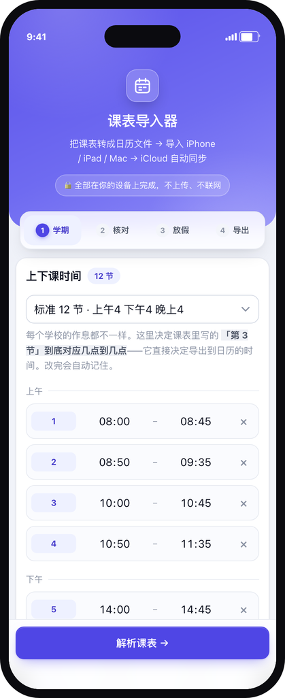
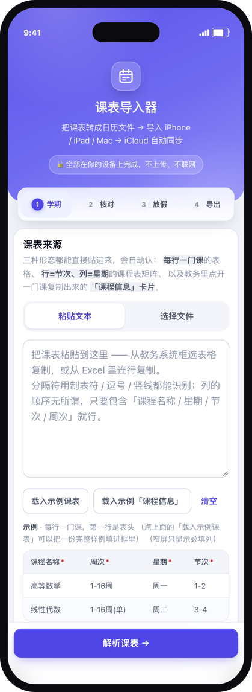

# 课表导入器 · Schedule Importer

把课表转成 `.ics` 日历文件，导入 iPhone / iPad / Mac 后由 **iCloud 自动同步**。

**单个 HTML 文件，250 KB，双击即用。不联网、不上传、零依赖、不需要注册。**

<table>
<tr>
<td width="50%"></td>
<td width="50%"></td>
</tr>
<tr>
<td align="center"><sub>桌面 · 粘贴 / 上传课表</sub></td>
<td align="center"><sub>iPhone · 表格自动转成卡片</sub></td>
</tr>
</table>

---

## 为什么不是 App

浏览器**读不到**你的日历（没有这个 API），只能"写"——具体路径是生成 `.ics` 文件，
你点一下导入到系统日历，剩下交给 iCloud。所以这个项目的形态是"网页生成日历文件"，
而不是"App 直接往日历里塞数据"。

这带来一个后果，也是这个项目最重要的取舍：

| | |
|---|---|
| ✅ 能做 | 解析课表、展开周次、处理节假日调休、生成 `.ics`、导出可下载的 Excel 模板 |
| ✅ 能做 | 导入后由系统日历负责提醒与同步；导入到 iCloud 日历即跨设备同步 |
| ❌ 做不到 | 读已有日历 → 所以**无法**做增量更新、逐条删除、检测与已有日程的冲突 |
| ❌ 做不到 | 自动识别"这次导入是更新还是新增" |

替代方案在 README 末尾的[常见问题](#常见问题)里。

---

## 立即使用

1. 下载 [`dist/课表导入器.html`](dist/)（或在 Releases 里下载）
2. 双击，用浏览器打开 —— Safari / Chrome / Edge / Firefox 都可以
3. 粘贴课表 → 核对 → 填放假 → **下载 `.ics`**
4. **iPhone / iPad**：打开「文件」App → 「下载」→ 点那个 `.ics` → 日历预览 → 「添加全部」→ 选到你的 **iCloud** 日历
5. **Mac**：日历 App →「文件」→「新建日历」（命名如「课表 2026秋」）→ 双击 `.ics` 导入
6. 等 1–2 分钟，其他设备上就出现了

> **别选「我的 iPhone / 我的 Mac」**，要选 iCloud 账户下的日历，否则不会跨设备同步。

---

## 支持哪些课表格式

**文件**：`.xlsx` · `.csv` · `.tsv` · `.txt`（旧版 `.xls` 请先另存为 `.xlsx`）

**三种内容形态**，都会自动识别：

### 格式一 · 每行一门课

第一行是表头，之后每行一门课。教务系统导出的 Excel 基本都是这个。

| 列 | 必填 | 写法示例 |
|---|:--:|---|
| 课程名称 | ✅ | `高等数学` |
| 星期 | ✅ | `周一` / `星期一` / `礼拜一` / `1` |
| 节次 | ✅ | `1-2` / `1,2` / `第1-2节` |
| 周次 | ✅ | 见下方[周次写法](#周次写法) |
| 教师 | | `张老师` |
| 教室 | | `教一301` |

列的顺序无所谓，会按表头名自动对应。带 `*` 的是必填。

### 格式二 · 课程表矩阵

行是节次、列是星期，一格 = 一次课。格子里按行写 `课程名 / 教师 / 周次 / 教室`
（顺序不严格，会按关键词识别）。一门课跨几节就是一个合并单元格。

```
分组   节次      星期一        星期二
上午   3,4                    课程:高等数学
                           班级:数学1班
                           (教一301)
                           5,9,13周 星期二 中午2-6节
                           主讲教师:张老师
```

> 格子里有换行，CSV 存不下 —— 这种格式只能用 Excel。

### 格式三 · 课程信息卡片

在教务系统里点开一门课、把「课程信息」整段复制出来，就是这个样子：一行一个字段。
它没有表格结构，但**字段名最全，是最不容易认错的一种贴法**。

```
课程:高等数学
班级:高等数学 3
(教一301)
5,9,13周 星期四 中午2-6节
主讲教师:张老师
```

多门课直接把几张卡片连着贴，不用留空行。

### 周次写法

| 写法 | 含义 |
|---|---|
| `1-16周` | 连续 16 周 |
| `1-16周(单)` | 只在第 1、3、5… 周 |
| `1-16周(双)` | 只在第 2、4、6… 周 |
| `1-8,10-16周` | 两段，中间第 9 周没课 |
| `5,9,13周` | 罗列 |
| `1-16周 单双周` | **隔周上一次**（第 1、3、5… 周），课时减半 |

> ⚠️ **「单双周」是「隔周」的意思，不是「每周」。**
> 而 `1-16周(单)` / `(双)` 才是单双周，两者都以**本学期第 1 周**为基准。
> 如果你们学校按自然周或学年连续编号导致整好差一格，第 1 步有个开关可以切。

### 节次写法

| 写法 | 含义 |
|---|---|
| `1-2` | 连着上两节 |
| `1,3` | 第 1 和第 3 节（跳过第 2 节） |
| `第1-2节` | 带「第」「节」也行 |
| `中午1` `中午2-6` | **具名节次**：午休 / 早读这类不在 1…N 编号里的节次 |

> 「范围」是按**作息表里的位置**连着的，不是数字相减。
> `中午2-6` 指作息表上从 `中午2` 一路数到第 6 节。
> 用具名节次前，得先在第 1 步的「上下课时间」里把对应行加出来（选「11 节 + 中午 2 节」预设最快）。

页面上有**可下载的 Excel / CSV / TSV 模板**，也有每种格式的填写说明。

---

## 核心能力

### 上下课时间可编辑

不同学校作息差太多了，这一栏直接决定导出的事件时间。可逐节改、可增删、
可按「每节时长 + 课间」一键重排整张表，内置 6 套常见作息
（标准 12 节 / 11 节+中午 2 节 / 紧凑 10 节 / 轻量 8 节 / 大节制 6 节 / 中学 8 节）。
**填过一次就记住了**（存在 localStorage）。

<table>
<tr>
<td width="34%"></td>
<td width="33%"></td>
<td width="33%"></td>
</tr>
</table>

### 连堂怎么合并，你说了算

`中午2-6` 这种连上多节的课，到底合成几条日历事件？三种策略：

| 模式 | `中午2-6节`（中间夹着课间） |
|---|---|
| **按课间自动切分**（默认） | 拆成 `13:35–14:25` + `14:30–15:20` + `15:25–16:15` 三个事件，课间留作自由时间 |
| 连排合并为一个事件 | 一个 `13:35–16:15` 的事件，时长含课间 |
| 每节各自一个事件 | 三个事件，和上面第一种效果相同 |

### 放假 / 停课 / 补课

- 放假、国庆、停课 → 课次被排除
- 补课 → 作为独立事件加入
- 都有「一键添加国庆 / 元旦 / 劳动节」

### 用 EXDATE 而不是断开重复规则

日历文件里，「1–16 周每周」是一条规则，国庆停课写成 `EXDATE`。
好处是**规则不会被切碎**——同一门课不管加多少假期，仍然是一条规则、一个事件，
而不是断成十几条。同样的课表，如果靠"拆规则"实现，事件数会从 8 条涨到 19 条。

### 手机端

不是"桌面页面缩小"，是按 393pt 逻辑宽度重做的：表格自动变成卡片、
底部操作条吸底、步骤条吸顶、输入框字号抬到 16px（否则 iOS Safari 聚焦会放大整页）、
适配刘海与 Home 指示条。跟随系统深色模式。

<table>
<tr>
<td width="34%"></td>
<td width="33%"></td>
<td width="33%"></td>
</tr>
</table>

---

## 隐私

- 全部计算在浏览器里完成，**不发起任何网络请求**（打开页面后断网也能用）
- 不上传、不存储、不收集任何数据
- 作息表只存在你自己的 `localStorage` 里，清浏览器数据即消失
- 没有任何第三方脚本、字体、分析、CDN —— 打开 `dist/` 里那个 HTML，
  用浏览器的网络面板看，**一个请求都不会有**

---

## 从源码构建

```bash
git clone <this repo>
cd schedule-importer
npm install          # 只有测试需要（jsdom），构建本身零依赖
npm run build        # -> dist/课表导入器.html
```

`dist/` 里的产物是**提交进仓库**的，所以只是想用的人**不需要克隆，也不需要构建**，
直接下载那一个文件即可。

## 开发

```bash
npm test                  # 837 项断言（内核 / Excel / 界面）
npm run test:core         # 只跑内核
npm run verify            # build + test

npm run fixtures          # 重新生成测试用的 xlsx（纯 Python，无依赖）
npm run previews          # 生成"交互到某一步"的页面副本到 /tmp
npm run screenshots       # 重拍 docs/screenshots/（需要 Chrome + Pillow）
npm run check:align       # 量表头与内容的像素偏差、下拉箭头间距
npm run sample:xlsx       # 重新生成 docs/课表模板-示例.xlsx
```

**改代码的顺序**：只改 `src/` → `npm run build` → `npm test` → `npm run screenshots`。
`dist/` 是产物，**永远不要手改**。

### 目录结构

```
src/
  core.js        内核：周次解析 / 节次展开 / 切段 / EXDATE / ICS 生成 / xlsx 读写
                 纯计算，不碰 DOM、不联网。浏览器与 Node 共用同一份。
  ui.js          界面：状态、渲染、事件绑定
  template.html  页面骨架 + 全部样式（设计令牌在文件开头的 :root）
tools/           构建与校验脚本（不进 dist）
tests/           测试 + 测试数据（fixtures/ 与 UID 基线）
dist/            唯一交付物：课表导入器.html
docs/            截图、模板示例
```

### 测试都是做什么的

| 测试 | 断言 | 覆盖 |
|---|--:|---|
| `test-core.js` | 402 | 周次/节次解析、展开、EXDATE、ICS 生成、UID 确定性、**基线逐字节比对** |
| `test-xlsx.js` | 150 | 自研 ZIP 读写、OOXML 引用完整性、两种课表形态识别 |
| `test-ui.js` | 285 | jsdom 真实交互路径、主题与移动端结构 |

其中有一条**基线比对**（`tests/baseline.ics`）：把已知课表算出的所有 UID 与事件
存成基线，任何改动都不能让它漂移。**改了周次/节次/UID 的生成逻辑却没同步更新基线，
测试就会失败** —— 这是防止"改了点什么，日历里悄悄多出几周的课"的最后一道闸。

---

## 已知限制

1. **重复导入会产生重复事件。** 日历文件是"新增"语义，不会覆盖上一次的。
   调课要重新导入时，先在日历 App 里**取消勾选隐藏**旧日历（1 步，随时可恢复），
   确认新课表没问题再删。
2. **不支持 PDF / 图片 OCR。** 中文 OCR 的体验打磨成本远超预期，
   而教务系统最常见的导出形态是 Excel，覆盖了大部分场景。
3. **不支持订阅日历（webcal）。** 那是最优解（课表更新时用户 0 操作），
   但需要一个 HTTPS 直链把课表编码进 URL。
4. **`.xls`（BIFF8）打不开。** 请先另存为 `.xlsx` 或 `.csv`。
5. **在 `<textarea>` 里没法把中英混排的表格排整齐。** 中文 1.0em、等宽拉丁 0.6em，
   比值不是整数，制表位必然漂移。所以空状态下的示例改用真 `<table>` 渲染。
6. 浏览器下限：Chrome 80+ / Safari 16.4+ / Firefox 113+（需要 `CompressionStream`
   来写 xlsx）。

---

## 常见问题

**重复导入会不会长出重复事件？**
会。但事件 UID 是由内容确定性推导的，**同一个课表重复导入时 UID 完全一致**，
`tests/baseline.ics` 守着这条性质。系统日历的导入行为取决于客户端，
建议按上面的办法先隐藏旧日历。

**为什么不直接上架 App Store？**
原生方案（EventKit）技术上可行，能读日历、能增量更新、能检测冲突，
但需要开发者账号、走审核、每次更新都要发版，而且各校作息差异太大时，
还是得先让用户填一遍「上下课时间」。网页版本改完立刻生效，填一次记住一年。

**能加"订阅日历"吗？**
能，而且那是最优解。需要一个 HTTPS 直链把课表编码进 URL，
用户添加到"已订阅的日历"后就能自动更新。本仓库暂未包含。

**为什么不用 SheetJS / ics.js 之类的库？**
因为 `.ics` 生成必须用上 `EXDATE`，而绝大多数库不支持；
`.xlsx` 读写则用浏览器原生的 `CompressionStream` / `DecompressionStream`
加自己拼的 ZIP 结构（约 170 行）实现。
零依赖换来的是"下载一个文件就能用"，对这类工具来说比复用更重要。

---

## 许可

MIT，见 [LICENSE](LICENSE)。

示例中的课程名、教师名、教室均为虚构。