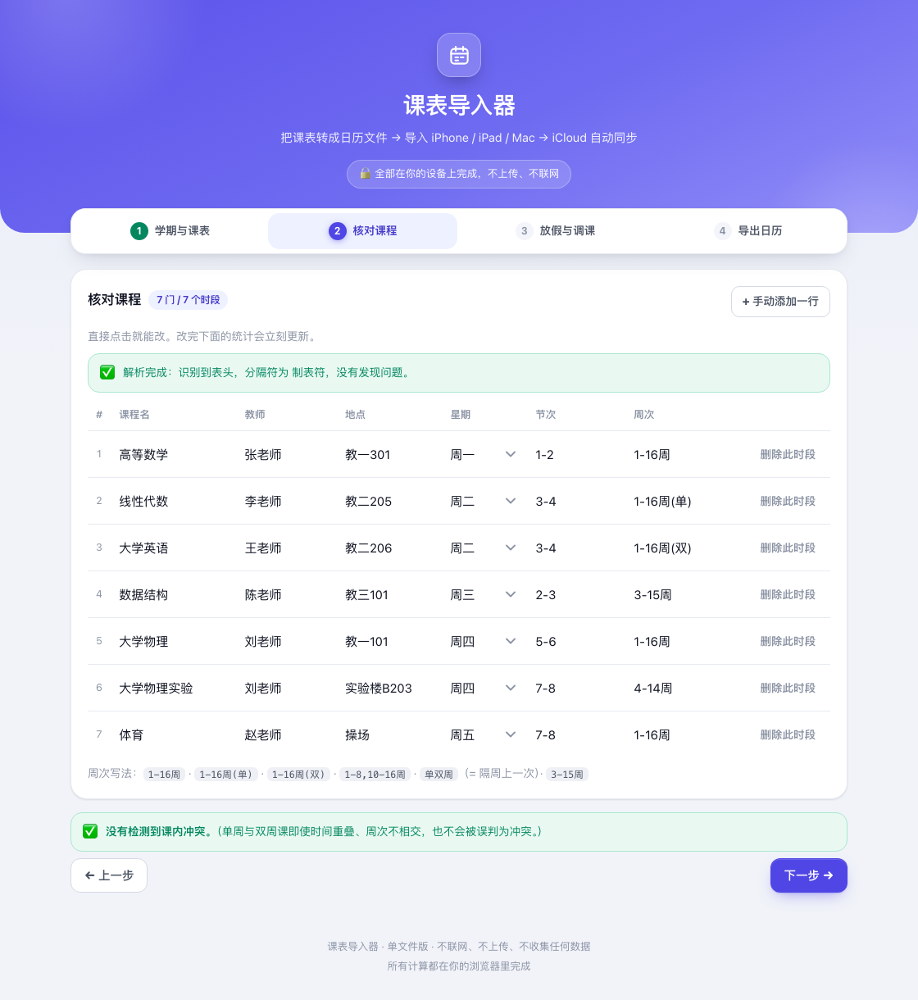
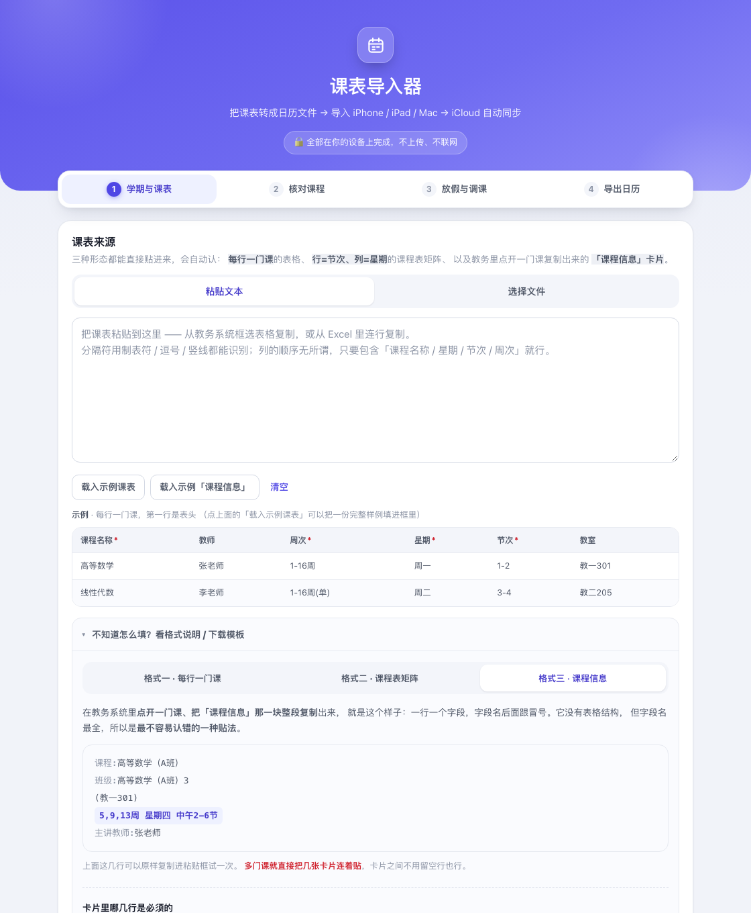
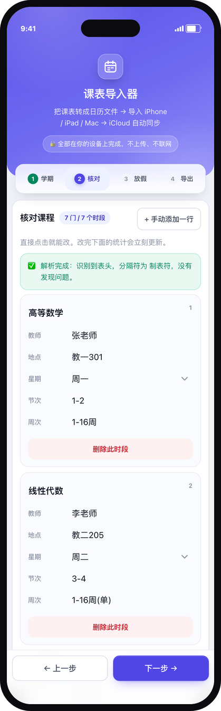
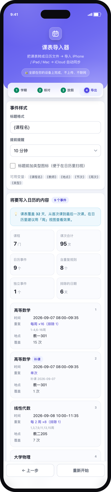
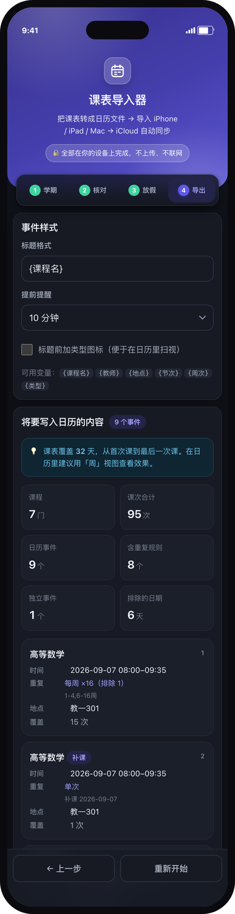

<div align="center">

# 课表导入器

**把课表变成日历。一个 HTML 文件，双击就能用。**

[](LICENSE)
[](package.json)
[](tests/)
[](#隐私)

<sub>单文件 250 KB · 无需安装 · 无需注册 · 数据不出浏览器</sub>

<a href="#快速开始">快速开始</a> ·
<a href="#支持的课表">支持的课表</a> ·
<a href="#工作原理">工作原理</a> ·
<a href="#开发">开发</a> ·
<a href="#常见问题">常见问题</a>

</div>

<p align="center">
  
  <br>
  <sub>课表粘进来 → 自动拆成一条条可编辑的课程 → 核对无误后导出 .ics</sub>
</p>

导入 iPhone / iPad / Mac 的 **iCloud 日历**后，设备之间自动同步；学期中调课了，
重新生成一份再导入即可。

---

## 快速开始

1. 打开 [`dist/课表导入器.html`](dist/课表导入器.html)，点右上角的下载图标
   （Download raw file）保存到本地
2. 双击它，用浏览器打开（Safari / Chrome / Edge / Firefox 都行）
3. 粘贴课表 → 核对识别结果 → 填上放假 → **下载 `.ics`**
4. 导入日历：
   - **iPhone / iPad**：文件 App →「下载」→ 点那个 `.ics` → 日历预览 →「添加全部」→
     选到 **iCloud 账户下的日历**
   - **Mac**：日历 App →「文件」→「新建日历」（比如「课表 2026 秋」）→ 双击 `.ics` 导入

5. 等 1–2 分钟，其他设备上就出现了。

> **别选「我的 iPhone / 我的 Mac」**——那些是本地日历，不会跨设备同步。
> 不确定时就先建一个专用日历，命名成「课表 2026 秋」，以后好找也好删。

页面打开后断网也能用。它没有后端，也没有埋点。

---

## 它能做什么

### 三种课表形态，自动识别

每行一门课的长表、行是节次列是星期的矩阵、以及教务系统里「课程信息」那种字段卡片，
都能直接粘或拖进来。带标记的格子会按标记认（`课程:` / `班级:` / `主讲教师:`），
没有标记就按位置和关键词猜，猜完请你核对。详见[支持的课表](#支持的课表)。

### 作息表跟着学校走

「第 3 节」到底几点？每所学校都不一样，所以上下课时间是可编辑的：逐节改、增删、
按「每节时长 + 课间」一键重排。内置 6 套常见作息，其中一套是「11 节 + 中午 2 节」——

```
上午 1 2 3 4 → 中午1 → 中午2 → 下午 5 6 7 8 → 晚上 9 10 11
```

午休里排课的学校不用再把中午的课硬塞进第 5 节。填过一次就记住（存在本地）。

<table>
<tr>
<td width="50%"></td>
<td width="50%"></td>
</tr>
<tr>
<td align="center"><sub>逐节可改、可增删、可一键重排</sub></td>
<td align="center"><sub>每种格式都有示例与可下载模板</sub></td>
</tr>
</table>

### 连堂怎么合并，你说了算

同一段连排节次要不要合成一条日历事件？三种策略：

| 模式 | `1-3节`（第 2、3 节之间是 30 分钟大课间） |
|---|---|
| **按课间自动切分**（默认） | 两条：`08:00–09:35` + `10:00–10:45`。课间留给你，不被事件占掉 |
| **连排合并为一个事件** | 一条：`08:00–10:45`，时长包含课间 |
| **每节各自一个事件** | 三条：`08:00–08:45` / `08:50–09:35` / `10:00–10:45` |

第一种的阈值默认 5 分钟（可调）。所以 `中午2-6节` 三节之间各 5 分钟课间时，
默认会合成一条 `13:35–16:15`；如果中间夹着大课间，就在那里断开。

### 放假、停课、补课

- 放假、国庆、临时停课 → 那几天的课次被排除
- 补课 → 作为独立事件加进来
- 国庆 / 元旦 / 劳动节有快捷按钮，也可以逐天手动加

### 事件不会被假期切碎

「1–16 周每周」在日历文件里仍然是**一条重复规则**，国庆停课写成 `EXDATE`。
同样一份课表，如果靠「把规则断开」来实现，事件数会成倍增加（实测从 8 条涨到 19 条），
而且用户改一次时间就可能对不上。

### 手机端是重做的，不是缩小的桌面页

按窄屏逻辑宽度重新排版：表格自动变成卡片、操作条吸底、步骤条吸顶、
输入框字号抬到 16px（否则 iOS Safari 聚焦时会放大整页）、适配刘海与 Home 指示条，
跟随系统深色模式。

<table>
<tr>
<td width="33%"></td>
<td width="33%"></td>
<td width="34%"></td>
</tr>
<tr>
<td align="center"><sub>表格 → 卡片</sub></td>
<td align="center"><sub>导出前能逐条核对</sub></td>
<td align="center"><sub>深色模式</sub></td>
</tr>
</table>

---

## 支持的课表

**文件**：`.xlsx` · `.csv` · `.tsv` · `.txt`
（旧版 `.xls` 请先在 Excel / WPS 里另存为 `.xlsx`）

三种内容形态都会自动识别。

### 格式一 · 每行一门课

第一行是表头，之后每行一门课。教务系统导出的 Excel 基本都是这个形态。

| 列 | 必填 | 写法示例 |
|---|:--:|---|
| 课程名称 | 是 | `高等数学` |
| 星期 | 是 | `周一` / `星期一` / `礼拜一` / `1` |
| 节次 | 是 | `1-2` / `1,2` / `第1-2节` |
| 周次 | 是 | 见[周次写法](#周次写法) |
| 教师 | | `张老师` |
| 教室 | | `教一301` |

列的顺序无所谓，会按表头名自动对应。

### 格式二 · 课程表矩阵

行是节次、列是星期，一格 = 一次课。一门课跨几节就是一个合并单元格。

| 分组 | 节次 | 星期一 | 星期二 |
|---|---|---|---|
| 上午 | 3 | | 科技英语（合并 3–4 行） |
| | 4 | | |
| 中午 | 中午1 | | |
| | 中午2 | 数字集成电路（合并 中午2 / 5 / 6 行） | |

格子里的内容长这样——带字段名最准，不带也能认：

```
课程:数字集成电路设计
班级:数字集成电路设计2
(A330)
3-18周 星期一 中午2-6节
主讲教师:曾泽沧
```

- 单独一行的括号 `(A330)` 会被当作教室
- 周次和节次写在同一句里没问题
- **节次以格子里写的那一句为准**，行首只用来定位。合并单元格的值只在第一行，
  两者不一致时会提示你核对

> 格子里有换行，CSV 存不下 —— 这种格式只能用 Excel。

### 格式三 · 课程信息卡片

在教务系统里点开一门课、把「课程信息」整段复制出来。它没有表格结构，
但字段名最全，是最不容易认错的一种贴法。多门课连着贴就行，不用空行。

### 周次写法

| 写法 | 含义 |
|---|---|
| `1-16周` | 连续 16 周 |
| `1-16周(单)` / `1-16周(双)` | 只在单周 / 双周 |
| `1-8,10-16周` | 两段，中间第 9 周没课 |
| `5,9,13周` | 罗列 |
| `单双周` / `隔周` | 隔周上一次（第 1、3、5… 周） |

> 单双周的奇偶以**本学期的第 1 周**为基准。有的学校按自然年周数或学年连续编号，
> 会正好差一格；第 1 步有个「第 1 周 = 双周」的开关可以切。

### 节次写法

| 写法 | 含义 |
|---|---|
| `1-2` | 连着上两节 |
| `1,3` | 第 1 和第 3 节（跳过第 2 节） |
| `第1-2节` | 带「第」「节」也行 |
| `中午1` / `中午2-6` | **具名节次**：午休、早读这类不在 1…N 编号里的节次 |

> 范围按**作息表里的位置**连着数，不是数字相减：`中午2-6` 指从作息表上的
> `中午2` 一路数到第 6 节。用具名节次前，先在「上下课时间」里把那一行加出来
> （选「11 节 + 中午 2 节」预设最快）。
> 作息表里没有的写法会明确提示你去补，**不会**悄悄当成第 1 节。

页面上有可下载的 Excel / CSV / TSV 模板，每种格式都带填写说明。

---

## 工作原理

```
课表文件 / 粘贴文本
        │  解析：先认字段标记，认不出再按位置和关键词猜
        ▼
  课程 · 周次 · 节次 · 日期例外
        │  展开：周次 × 星期 → 具体日期（BigInt 位掩码管 53 周）
        ▼
     时间块 → 事件（UID 由内容确定性推导）
        │  切段：连续周合并成一条 RRULE；停课写成 EXDATE
        ▼
       .ics
```

- 日期一律按「墙钟时间 + 固定 UTC 偏移」处理，导出时写 UTC。
  跨设备、跨时区打开都不会错位。
- UID 用内容推导（UUIDv5），同一份课表重复生成得到**完全相同的 UID**。
  这样重复导入时，客户端有机会把它认成同一批事件，而不是一堆新事件。
- `.ics` 生成用的是原生 `EXDATE`，所以假期不会把一条规则切成十几条。

---

## 设计边界

浏览器**读不到**你的日历（没有这个 API），只能「写」——具体路径是生成 `.ics`
文件，你点一下导入系统日历。所以这个项目的形态是「网页生成日历文件」，
而不是「App 直接往日历里塞数据」。

| 能做到 | 做不到 |
|---|---|
| 解析课表、展开周次、处理节假日调休 | 读已有日历 |
| 生成 `.ics`，导入 iCloud 后跨设备同步 | 增量更新、逐条删除 |
| 导出可下载的 Excel 模板 | 检测与已有日程的冲突 |
| 完全离线、零依赖 | 自动判断「这次导入是更新还是新增」 |

替代方案见[常见问题](#常见问题)。

---

## 隐私

- 全部计算在浏览器里完成，**不发起任何网络请求**（打开页面后断网也能用）
- 不上传、不存储、不收集任何数据
- 作息表只存在你自己的 `localStorage` 里，清浏览器数据即消失
- 没有第三方脚本、字体、分析、CDN

想验证的话：打开 `dist/` 里那个 HTML，切到浏览器的网络面板，**一个请求都不会有**。

---

## 开发

```bash
git clone https://github.com/yuanyihuairuo/schedule-importer.git
cd schedule-importer
npm install          # 只有测试需要 jsdom，构建本身零依赖
npm run verify       # build + 全部测试
```

`dist/` 里的产物是**提交进仓库**的，所以只是想用的人不需要克隆，也不需要构建。

**改代码的顺序**：只改 `src/` → `npm run build` → `npm test` →（改了界面才）`npm run screenshots`。
`dist/` 是产物，不要手改。

### 目录结构

| 路径 | 内容 |
|---|---|
| `src/core.js` | 内核：周次/节次解析、展开、切段、EXDATE、ICS 生成、xlsx 读写。纯计算，不碰 DOM、不联网，浏览器与 Node 共用同一份 |
| `src/ui.js` | 界面：状态、渲染、事件绑定 |
| `src/template.html` | 骨架 + 全部样式（设计令牌在 `:root`） |
| `tools/` | 构建与校验脚本（不进 dist） |
| `tests/` | 测试 + 测试数据（`fixtures/`、UID 基线） |
| `dist/` | 唯一交付物：`课表导入器.html` |
| `docs/` | 截图与模板示例 |

### 命令

| 命令 | 作用 |
|---|---|
| `npm test` | 837 项断言：内核 / Excel / 界面 |
| `npm run test:core` | 只跑内核 |
| `npm run build` | 合成 `dist/课表导入器.html` |
| `npm run verify` | build + test |
| `npm run fixtures` | 重新生成测试用 xlsx（纯 Python，无依赖） |
| `npm run previews` | 生成「交互到某一步」的页面副本到 `/tmp` |
| `npm run screenshots` | 重拍 `docs/screenshots/`（需要 Chrome + Pillow） |
| `npm run check:align` | 量表头与内容的像素偏差 |
| `npm run sample:xlsx` | 重新生成 `docs/课表模板-示例.xlsx` |

### 测试都在测什么

| 测试 | 断言 | 覆盖 |
|---|--:|---|
| `tests/test-core.js` | 402 | 解析、展开、EXDATE、ICS 生成、UID 确定性、基线逐字节比对 |
| `tests/test-xlsx.js` | 150 | 自研 ZIP 读写、OOXML 引用完整性、两种课表形态识别 |
| `tests/test-ui.js` | 285 | jsdom 里的真实交互路径、主题与移动端结构 |

其中有一条**基线比对**（`tests/baseline.ics`）：把已知课表算出的全部 UID 与事件
存成基线，任何改动都不能让它漂移。改了周次/节次/UID 的生成逻辑却没同步更新基线，
测试就会失败——这是防止「改了点什么，日历里悄悄多出几周的课」的最后一道闸。

改之前建议先读 [`CONTRIBUTING.md`](CONTRIBUTING.md)，里面写了内核的四条硬约定
（墙钟时间、确定性 UID、EXDATE 优先、`BigInt` 周次掩码）和四条提交规矩。

---

## 已知限制

1. **重复导入会产生重复事件。** 日历文件是「新增」语义，不会覆盖上一次的。
   调课要重新导入时，先在日历 App 里**取消勾选隐藏**旧日历（1 步，随时可恢复），
   确认新课表没问题再删。
2. **不支持 PDF / 图片 OCR。** 中文 OCR 的打磨成本远超预期，而教务系统最常见的
   导出形态是 Excel。
3. **不支持订阅日历（webcal）。** 那是最优解（课表更新时用户 0 操作），
   但需要一个 HTTPS 直链把课表编码进 URL，本仓库暂未包含。
4. **`.xls`（BIFF8）打不开。** 请先另存为 `.xlsx` 或 `.csv`。
5. **在 `<textarea>` 里排不齐中英混排的表格。** 中文 1.0em、等宽拉丁 0.6em，
   比值不是整数，制表位必然漂移。所以示例区改用真 `<table>` 渲染。
6. **浏览器下限**：Chrome 80+ / Safari 16.4+ / Firefox 113+（写 xlsx 需要
   `CompressionStream`）。

---

## 常见问题
<details>
<summary><b>重复导入会不会长出重复事件？</b></summary>

会。日历文件是新增语义。但事件 UID 由内容确定性推导，同一份课表重复导入时
UID 完全一致，`tests/baseline.ics` 守着这条性质。稳妥的做法是先隐藏旧日历再导入。

</details>

<details>
<summary><b>为什么不直接上架 App Store？</b></summary>

原生方案（EventKit）技术上可行，能读日历、能增量更新、能检测冲突，但需要开发者账号、
走审核、每次更新都要发版。而各校作息差异太大，不管哪种形态都得先让用户填一遍
「上下课时间」。网页版改完立刻生效，填一次记住一年。

</details>

<details>
<summary><b>能加「订阅日历」吗？</b></summary>

能，而且那是最优解：用户把它加进「已订阅的日历」后，课表更新是 0 操作。
代价是需要一个 HTTPS 直链（网盘的分享页不是直链，拉取会失败），所以没放进这个单文件版本。

</details>

<details>
<summary><b>为什么不用 SheetJS / ics.js 之类的库？</b></summary>

`.ics` 必须能写 `EXDATE`，而大多数库不支持；`.xlsx` 读写用浏览器原生的
`CompressionStream` / `DecompressionStream` 加自研的 ZIP 结构就够。零依赖换来的是
「下载一个文件就能用」，对这类工具来说比复用更重要。

</details>

---

## 许可

[MIT](LICENSE) © 2026 YUANYIHUAIRUO

示例中的课程名、教师名、教室均为虚构。
